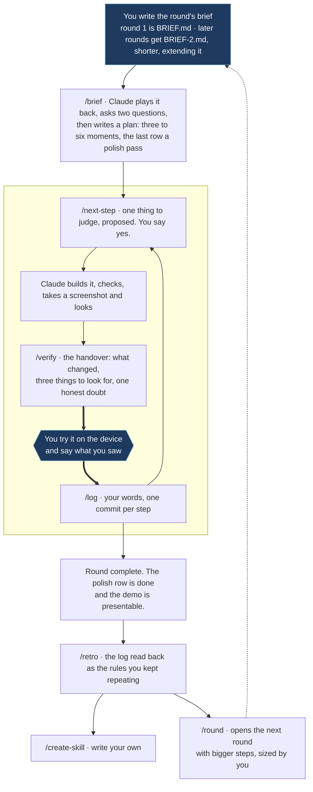

# FM-12 process harness

This is a small process you add to the FM-12 WebXR sandbox template. The harness moderates how a mixed reality prototype gets designed and built with Claude Code. It keeps the conversation on the interaction and what the person experiences instead of on the code.

It is intended to be used by a designer working from concept to demoable prototype. The goal of the harness is to highlight the process itself and help designers stay in a close loop of the developments, make decisions as they go and therefore unlock creativity step by step, rather than reviewing and course correcting built milestones.


## The loop

Every build turn results in a **handover**: Claude says what changed, how to try it on the device, and three things to look for. Nothing more gets built until the designer has said what they saw and what they want to improve. The outer circle is a **round**, which means one brief, one plan that ends in a polish pass, and the steps between. When one round completes, a new one can be started to follow the same process and continue or refine the project.



Two things in the harness are enforced rather than advised. A hook refuses any edit under `src/` until the round 1 brief is filled in, and once a plan exists it falls silent for good, so a later round never stands in the way of a quick fix to what was already built. And the template's engine, a new dependency or a first call to an outside service each need an explicit yes from the designer.

## Install

From inside your template folder:

```sh
npx -y github:spaceunlimited/FM-12_process-harness
```

The installer copies `harness/` in and never overwrites anything, so the three items can just as well be moved in by hand. Step by step instructions, including how to update it and how to take it out again, are in [`harness/process/INSTALL.md`](harness/process/INSTALL.md).

What arrives is documentation only: a `.claude/` folder with one memory file, two path rules, two small hooks and nine skills, a `BRIEF.md` template, and a `process/` folder holding the install notes, the log and the story behind every guardrail. It changes no template file and adds no dependency.


## Why it exists

It's intended to teach two things:
1. A harness adds a *process*, and different projects need different ones.
2. Slowing down when going from concept to demoable prototype makes room for better and more refined ideas.

The problem is not that the agent writes bad code, but that it fills in the gaps so quickly that a potentially unique concept gets nudged into average directions. Filling in those gaps, the agent also tips the scale from unlocking creativity on the designer's side towards a course correcting and bug fixing mindset.

Every rule here came from a session where that, or something like it, went wrong. [`harness/process/WHY.md`](harness/process/WHY.md) tells each story, including the rules we deleted again. A rule you cannot explain is not yours.

## What it requires, and where it stops

On the tool side it asks for very little: Claude Code, which supplies the project memory, the hooks, the skills and the path rules, plus Node 20 or newer. git is optional, the harness notices when it is missing and carries on without it.

What the harness really requires is a **curated** base project. `CAPABILITIES.md` is a closed list of building blocks with snippets that can be copied. That list is what keeps the agent composing instead of inventing architecture, what keeps it out of the engine, and what gives the designer a quick vocabulary of what is possible. A good part of why this harness works is that the template was curated well before the harness existed.

Where nobody has drawn that boundary, the harness can still set the pace of the work, but it cannot govern what gets built, and the person deciding then needs more technical judgement than the process otherwise asks of them.

That leaves four limits worth knowing before taking it somewhere else:
1. **A capability list written by hand rots.** It holds here because the template stays frozen for a semester. On a codebase that keeps moving, the list has to be generated from the code or dropped altogether, because a stale list is worse than none: the agent trusts it and builds on something that is no longer there.
2. **Rule 4 needs eyes and a room.** The first look is the template's `npm run screenshot`, and the real test is a person holding a device. A project with nothing to look at has nothing to hand over, so the loop loses the moment that makes the designer decide.
3. **One designer, one prototype.** There is nothing here for two people building in parallel, for a review step between them, or for a codebase large enough that "one visible change" stops being obvious.
4. **A UX demo, not a product.** Fidelity gets declared in the brief and faking is the default, which suits one person, one path and one room. Strangers using the result unattended is a different goal and needs a different process.

Porting the harness to another project means deciding four things: which commands the project runs, which zone the agent owns, what takes the place of `CAPABILITIES.md`, and what "try it on the device" means there. Those names then get swapped in `.claude/CLAUDE.md`, the two path rules, `settings.json` and three of the skills. Doing that substitution is the first of the two lessons above, done for real instead of read.

Version: see the first line of `harness/.claude/CLAUDE.md`.
